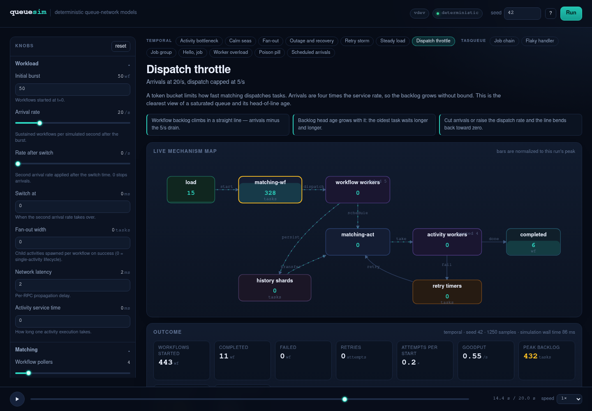
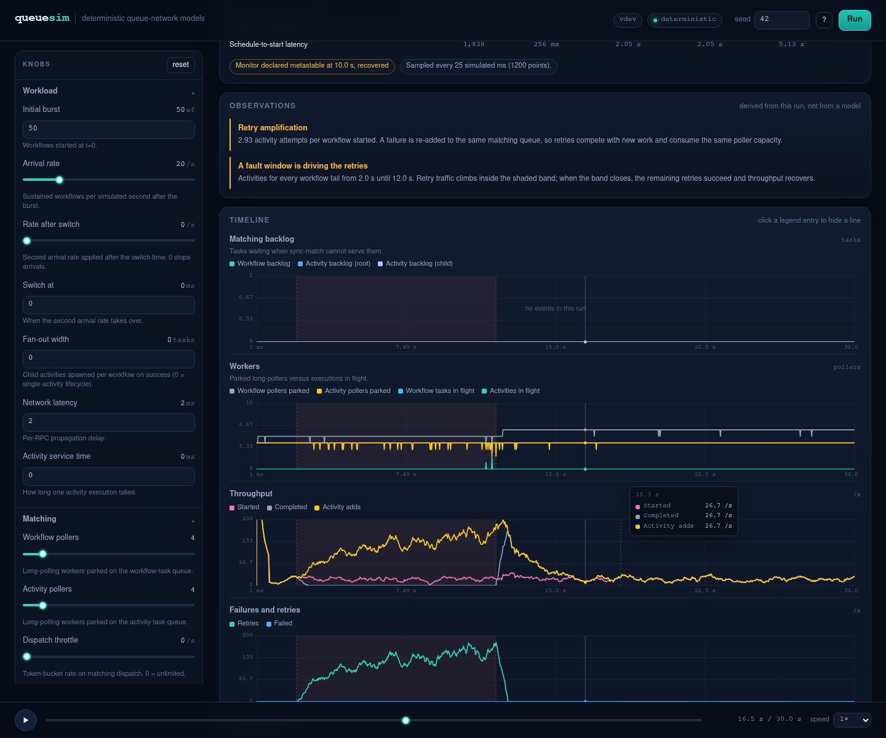

# queuesim

**Watch a queue network think.**

`queuesim` turns two real distributed-systems designs into deterministic,
interactive simulations: **Temporal's matching + history machinery** and a
**Tasqueue worker pool**. There is no cluster, no Docker, and no wall clock —
a seeded event loop advances simulated milliseconds, and a web dashboard lets
you watch every queue, turn every knob, and replay any run bit-for-bit.



## Quick start

Requires Go 1.25 or newer.

```bash
git clone https://github.com/lawRathod/queuesim
cd queuesim
go run ./cmd/queuesim serve -open
# or, once you trust it:
go install github.com/lawRathod/queuesim/cmd/queuesim@latest && queuesim serve -open
```

The dashboard starts on <http://localhost:8080>. Everything it needs is
embedded in the binary: no npm, no CDN, no network access.

Prefer the terminal?

```bash
go run ./cmd/queuesim list
go run ./cmd/queuesim run -scenario throttle
go run ./cmd/queuesim run -scenario retry-storm -set retry_max_attempts=8
go run ./cmd/queuesim export -scenario outage -o trace.json
```

## What you can do

- **Pick a scenario.** Fifteen curated experiments show healthy behaviour,
  retry amplification, worker bottlenecks, outages, fan-out, chains, groups,
  poison jobs, and scheduled work.
- **Turn knobs.** Arrival rate, poller counts, dispatch throttles, retry
  budgets, fault windows, shard counts, queue capacities, worker concurrency.
  Every knob explains itself in the UI.
- **Watch the mechanism map.** Queue depths fill as tasks accumulate; parked
  pollers and in-flight executions update live while the timeline plays.
- **Read the observations.** Every run ends with rule-derived notes that name
  the mechanism the numbers point at ("the dispatch throttle is the
  bottleneck", "retry amplification", "the activity fleet is saturated") —
  a starting hypothesis, not a verdict.
- **Scrub and hover the timeline.** Hover any chart for the value at that
  instant; click to jump the playhead. The whole trace is downloadable JSON,
  not a screenshot.
- **Prove determinism.** *Verify replay* reruns the exact request and compares
  the digest. *Sweep seeds* runs the same config across eight seeds — enough
  to see which conclusions are robust and which are one random draw.
- **Compare runs.** Pin a run, change a knob, run again: KPI deltas and ghost
  lines show what changed. The **Copy CLI** button turns the same experiment
  into a command you can rerun in a terminal.

### The timeline, up close



The observations are rule-derived from the same trace you can download; the
tooltip and the click-to-scrub cursor make the trace an instrument rather than
a picture.

## Why determinism is the point

Randomness in a queueing simulation is usually a debugging tax: a surprising
result may be a bug or may be the seed. Here the simulation is single-goroutine,
pump-driven, and all randomness comes from named, seeded streams. The same
configuration and seed produce the same events in the same order, and the same
monitor digest. Results become reproducible experiments:

```
seed 42, dispatch_rate=5  →  digest counters[5]{...} gauges[11]{...}
seed 42, dispatch_rate=5  →  digest counters[5]{...} gauges[11]{...}   ✓ identical
seed 43, dispatch_rate=5  →  digest counters[5]{...} gauges[11]{...}   different world
```

That is also why the UI can animate freely: sampling the model is a pure read,
so attaching the visualization hook does not move the trace.

## Scenarios

| Temporal | What it shows |
|---|---|
| Activity bottleneck | One poller against 40 wf/s: the activity backlog grows, S2S latency explodes |
| Calm seas | The healthy baseline: everything sync-matches, nothing queues |
| Fan-out | Each workflow spawns K children, multiplying activity load |
| Load drop, slow recovery | The load falls but the backlog tail outlives it |
| Outage and recovery | A fault window + exponential backoff: retries damp, then recover |
| Retry storm | Half the workflows fail: attempts per start is the amplification |
| Steady load | Sustained arrivals reach a steady state |
| Dispatch throttle | Arrivals outrun a token bucket: linear backlog growth and head age |

| Tasqueue | What it shows |
|---|---|
| Job chain | OnSuccess chains: four sequential handler attempts per chain |
| Flaky handler | 40% failures with three retries: hidden retry cost |
| Job group | Five-member groups that join only if every member succeeds |
| Hello, job | The smallest possible worker-pool run |
| Worker overload | 100 jobs, two workers, 50 ms each: bounded drain rate |
| Poison pill | Every attempt fails; OnError spawns cleanup work |
| Scheduled arrivals | Periodic bursts: saw-tooth backlog between ticks |

## How it is built

```
cmd/queuesim        CLI: serve, list, run, export
internal/webui      HTTP API + embedded frontend (vanilla JS, no build step)
internal/lab        scenario catalog, run orchestration, JSON traces
model/              modeling library: TaskQueue, Processor, Worker, Network, System
models/temporal     Temporal matching/history model
models/tasqueue     Tasqueue queue/worker model
godes/              deterministic simulation engine (vendored GoDES fork)
```

The engine runs a discrete-event core; the models drive it with a 1 ms pump
tick. `internal/lab` runs a scenario, samples the live state every few ticks,
derives per-second rates, and returns one JSON document containing the trace,
summary metrics, observations, percentiles, annotations, and digest. The server keeps no
state: every response is the artifact.

See [docs/architecture.md](docs/architecture.md) for the data flow,
determinism contract, and how to add a scenario, and
[docs/models.md](docs/models.md) for the mechanics each model reproduces.

## API

| Method | Path | Purpose |
|---|---|---|
| `GET` | `/api/meta` | version, Go version, effective `DSTSEED` |
| `GET` | `/api/scenarios` | catalog: knobs, presets, chart and series metadata |
| `POST` | `/api/runs` | run `{scenario, seed, knobs}` synchronously; returns the full trace |
| `POST` | `/api/runs/sweep` | run one config across `count` seeds, return digests |
| `GET` | `/healthz` | liveness |

`POST /api/runs` is intentionally synchronous and self-contained; traces are
small (100–150 KB) and runs take tens to hundreds of milliseconds. Two
simulations may run concurrently; a third request gets `429`.

## Status and limits

- These are **models**, not the systems themselves. Constants are pinned to
  the real server where the source defines one, calibrated where it does not,
  and labeled as such in the model packages. Use the dashboard for mechanism
  intuition, not as a benchmark.
- The pump is a fixed 1 ms cadence riding on a discrete-event scheduler.
  Results are cadence-dependent; a 60 s run costs 60,000 sweep iterations.
- The Temporal model reproduces task-queue mechanics (sync-match, spooling,
  poller scaling, sticky queues, shards, retries). It does not model the
  frontend RPC surface, visibility, or cluster membership.
- Web UI concurrency is capped at two runs by design; the CLI has no cap.

## Provenance

`godes/` is a source fork of the GoDES simulation engine (MIT, Copyright ©
2026 Prateek Rathod), vendored so this repository builds standalone with no
private module dependency. See [godes/README.md](godes/README.md) and
[THIRD_PARTY_NOTICES.md](THIRD_PARTY_NOTICES.md).

Temporal and Tasqueue are trademarks of their respective owners. The models
here are independent, unofficial recreations for education.

## License

MIT — see [LICENSE](LICENSE).
