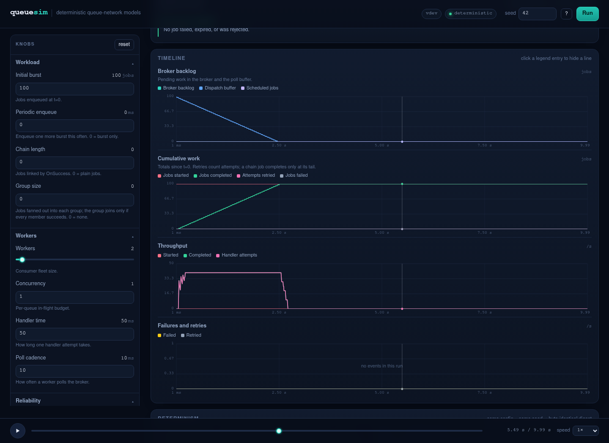

# The models

Two systems, one shape: work arrives, queues absorb it, workers drain it,
failures amplify it. The models differ in how much machinery sits between the
queue and the worker — and that machinery is what the dashboard exposes.

## Temporal: matching + history

Temporal is a workflow engine. A workflow start, an activity completion, and a
failed attempt all become **tasks** that a service must route to a **worker**
that is long-polling a **task queue**. The model reproduces the two services
that decide that routing — matching and history — and the retry loop between
them.

### Lifecycle

```
load (burst / arrivals)
  │ start workflow
  ▼
history: write to persistence ──► transfer queue
                                      │  (transfer batch per tick)
                                      ▼
                            matching-wf queue
                              │            │
                     sync-match            └─► spool to backlog
                        │                          │
                        ▼                          ▼
                   workflow worker  ◄──── poller drains backlog
                        │
                        │ schedule activity
                        ▼
                   matching-act queue  (root partition)
                        │
                        ▼
                   activity worker
                        │
             ┌──────────┴───────────┐
        success                 failure
             │                      │
             ▼                      ▼
      next workflow task       retry timer (history shard)
      (sticky queue or              │ backoff
       matching-wf)                 ▼
             │                matching-act again
             ▼
          complete
```

### The mechanisms that matter

**Sync-match vs spool.** An `Add` first tries to hand the task directly to a
parked poller. If no poller is available, the task spools to the backlog and a
later poll drains it. `SyncMatchWindowMs` (200 ms in the real server) is the
line between "this poller is fresh enough" and "this poller has been waiting so
long that the task should queue instead".

**Backlog-age gate.** Once the *oldest* backlogged task is older than
`BacklogGateMs` (5 s in the real server), the sync-match fast path is disabled
and adds go to the backlog. This prevents a fresh task from jumping ahead of a
task that has already waited too long.

**The child partition.** Activity tasks are written to a child partition before
they can be polled from the root. The child can forward to the root's poller
fleet only if the sync-match window is long enough (`ForwardReliableMinMs`).
When forwarding is unreliable, the child absorbs adds and can only drain at
`ChildDrainFraction × DispatchRate` — a structural bottleneck, not a rate knob
on the root queue. The UI shows root and child backlog separately.

**Dispatch throttle.** A token bucket (`DispatchRate`, `DispatchBurst`) caps
how fast matching hands tasks out. This is the cleanest way to build a backlog
without touching the worker fleet.

**Elastic pollers.** When the backlog persists past
`PollerScaleUpBacklogMs`, the active poller count scales toward
`PollerScaleMax`. The model's real-server pin is 200 ms.

**History shards.** Each shard owns a range of workflows (`task.ID % Shards`).
A mutation is written to persistence (`PersistMs`) and lands in one of three
queues: **transfer** (enter matching), **timer** (scheduled for later), and
**resched** (failed executions waiting out the reschedule backoff). Shards are
the persistence stage — they appear in the "History shard queues" chart and the
history node of the mechanism map.

**Sticky queues.** After an activity succeeds, the next workflow task for that
workflow is routed to the same worker (warm cache). If that worker is busy, the
task falls back to matching after `StickyFallbackMs`.

**Retries.** A failed activity is re-added with a backoff:
`RetryInitialMs × RetryCoeff^attempt`, capped at `RetryMaxAttempts` (0 =
unlimited). Retries re-enter the same matching queue, which is why failure is
amplifying rather than linear.

**Fan-out.** A successful workflow can spawn `FanoutK` child activities. Each
child is another activity add; the activity load becomes
`(FanoutK + 1) × workflow rate`.

**Time-varying load.** `ArrivalRate2` and `ArrivalSwitchMs` change the arrival
rate at a chosen time. A load drop drains the backlog at the fleet's spare
capacity, but head-of-line age peaks *after* the drop because the oldest tasks
are served last. The "Load drop, slow recovery" scenario traces that
hysteresis: the queue turns down at 10 s, the oldest wait peaks around 20 s.

**Fault window.** `FaultStartMs`/`FaultEndMs` open a window in which activities
fail. `CascadeBadFraction` restricts failure to a deterministic fraction of
workflow IDs — the "bad actors" — so retry traffic competes with healthy
traffic on the same queues.

### Reading the Temporal dashboard

| Signal | Meaning |
|---|---|
| `matching-wf` depth | Workflow tasks waiting for a poller |
| `matching-act` depth / child | Activity tasks waiting at the root / write partition |
| parked pollers | Long-polls currently parked, i.e. idle capacity |
| in-flight | Executions currently running |
| backlog head age | How long the oldest waiting task has waited |
| attempts / start | Retry amplification. 1.0 = first-try success, 3.0 = three attempts per workflow |
| sync-match share | Fraction of tasks handed directly to a poller (high = healthy) |
| schedule-to-start latency | From task entering matching to a poller taking it |

## Tasqueue: a broker and a polling fleet

Tasqueue is a smaller, more direct system: jobs go into a broker queue, workers
poll the queue on a cadence, run a handler, and either complete, retry, or fail.

```
producers ──► broker queue ──► dispatch buffer ──► worker poll ──► handler
                   ▲                                    │
                   │                                    ├─ success ─► done
             scheduled jobs (ETA)                       ├─ failure ─► retry (immediate)
                   ▲                                    └─ exhausted ─► failed ─► OnError jobs
                   └───────────────────────────────────────────────────┘
```

Mechanics:

- **Broker** (`queue_depth`): pending jobs. A capacity-full add is **rejected**
  and the job is terminal (the real in-memory broker blocks instead — a
  deliberate divergence, documented in the model).
- **Dispatch buffer**: jobs drained from the broker awaiting a poller take.
  The UI's "broker backlog" adds both.
- **Workers**: `NumWorkers` pollers with a per-queue `Concurrency` budget. A
  handler takes `ServiceMs`.
- **Retries**: a failed attempt is re-enqueued **immediately** (the real
  server does not back off), up to `MaxRetries`. The real server's effective
  default is 0: the declared `defaultMaxRetry = 1` is dead code, so a bare
  `JobOpts{}` makes the first error terminal. The model's `DefaultConfig` pins
  that effective default.
- **Deadline**: `MaxWaitMs` expires jobs that wait too long.
- **Drop rate**: a delivery can be dropped before reaching a handler. A dropped
  delivery consumes a retry but never increments handler attempts.
- **Chains** (`ChainLen`): each step enqueues its successor via `OnSuccess`.
  A chain completes only at its tail; a failure aborts the rest.
- **Groups** (`GroupSize`): a group fans out into members and joins only if all
  succeed. One failed member fails the group.
- **OnError** (`OnErrorJobs`): terminal failures enqueue cleanup jobs.
- **Scheduled** (`ScheduleEveryMs`): periodic bursts on top of the initial one.



### Reading the Tasqueue dashboard

| Signal | Meaning |
|---|---|
| broker + dispatch depth | Jobs waiting to be executed |
| handler in-flight | Workers currently executing |
| attempts / start | Handler attempts per job (chain steps inflate it by design) |
| enqueue → completion latency | End-to-end latency, including retries and chain steps |
| retried / failed rate | Failure pressure over time |

## Glossary

| Term | Definition |
|---|---|
| **Task** | One unit of work: `{ID, Attempt, Class, BornMs}` |
| **BornMs** | The simulated time a task entered the system; age = now − BornMs |
| **Sync-match** | Handing a task directly to an already-parked poller |
| **Spool** | Placing a task in the backlog because no poller was available |
| **Backlog head age** | Age of the oldest task in a queue |
| **Attempts per start** | Total attempts ÷ workflows started; the retry-amplification metric |
| **Goodput** | Successful completions per simulated second |
| **Pump** | The fixed-cadence tick that advances the model |
| **Digest** | Canonical serialization of final metrics; the determinism evidence |
| **Snapshot** | A pure, read-only sample of live model state |
| **Metastable** | A persistent degraded regime detected by the internal monitor |

## Honesty notes

These models are built for mechanism intuition. Where the real server defines a
constant, the model uses it and pins the source in `contract_test.go`; where it
does not, the value is calibrated or neutral and labeled as such in the model
package. The dashboard's numbers are simulated, not measured. In particular:

- No frontend RPC, visibility, or cluster-membership behaviour is modeled.
- The pump's 1 ms cadence is a modeling choice; results are cadence-dependent.
- The Tasqueue broker rejects where the real in-memory broker blocks.
- Failure, drop, and delay decisions are seeded, not sampled from live traffic.
